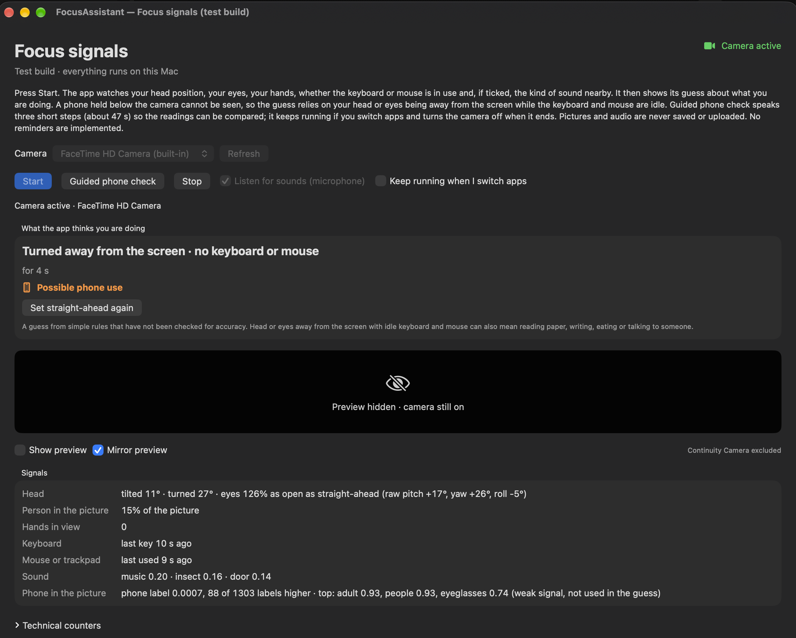

<div align="center">

# Doomore

**A Mac menu bar app that notices when you drift to your phone, and nudges you back to work.**

Private by design. Everything runs on your Mac. No pictures, audio or keystrokes are saved or sent anywhere.

[](https://github.com/AhmedNavaz/doomore/releases/latest)
[](https://github.com/AhmedNavaz/doomore/actions/workflows/ci.yml)
[](LICENSE)


[**Download for Mac**](https://github.com/AhmedNavaz/doomore/releases/latest) · [How it works](#how-it-works) · [Contribute](#contributing)

</div>



## Why

Picking up your phone "for a second" is how an hour disappears. Blockers on the Mac can't see the phone in your hand. Doomore watches the signs that you've looked away from your work, with your Mac's own camera and input idle time, and interrupts the habit while it is still a habit.

## What you get

- **Lives in the menu bar.** Start monitoring when you sit down. It stays quiet until it has a reason to speak, and it never starts by itself.
- **Notices the drift.** Head turned or tilted down, eyes lowered, hands off the keyboard, no mouse movement, all at once and for long enough to matter.
- **Pushes back, your way.** Pick **Gentle**, **Standard** or **Strict**. Warnings range from a quiet notification to a full-screen interruption with a looping sound.
- **Makes you pause on purpose.** Before the warning lets go you can be asked to wait 15 seconds, solve a quick math problem, type a commitment sentence, or stand up and stretch. Strict mode can also tuck other apps away. It hides them and never closes them, so no unsaved work is lost.
- **Knows when to stay quiet.** Video calls pause reminders. You can limit reminders to chosen work apps, take a 5 minute break, or pause.
- **Learns from you.** Tell it "Not a distraction" three times in a row and it becomes one step less sensitive.

## Install

1. Download `FocusAssistant-…-macOS.zip` from the [latest release](https://github.com/AhmedNavaz/doomore/releases/latest) and unzip it.
2. Move **FocusAssistant** to Applications.
3. The app is ad-hoc signed and **not notarized**, so macOS blocks the first open. Right-click the app, choose **Open**, then confirm. Or allow it in **System Settings → Privacy & Security**.
4. Choose **Start monitoring** from the menu bar icon and allow camera and notification access.

Requires an Apple silicon Mac. The deployment target is macOS 14, but it has only been run on macOS 27 so far. macOS asks for camera access again after you replace the app with a new build, because an ad-hoc signature has no stable identity.

## Privacy

| Question | Answer |
|---|---|
| Are camera frames saved or uploaded? | No. Frames are analysed in memory, two per second, and discarded. |
| What leaves the Mac? | Nothing. No network code, analytics or accounts. |
| Does it use the microphone? | Not while monitoring. |
| Does it read what I type or what's on screen? | No. It only reads how long ago the keyboard or mouse was last used, and the name of the app in front. No keys, clicks, window titles or content. |
| What permissions does it ask for? | Camera and notifications. No screen recording, accessibility or Input Monitoring. |
| Which models does it use? | Only the ones built into macOS (Vision). Nothing is downloaded or bundled. |

See [SECURITY.md](SECURITY.md) for details and how to report a problem.

## How it works

Doomore does not try to spot a phone in the picture. A phone held below the camera can't be seen, so it combines several signals instead:

| Signal | Source | What is read |
|---|---|---|
| Head position | Vision face request | Pitch, yaw and roll, compared with a straight-ahead position learned in the first three seconds |
| Eye outline | Vision face landmarks | Eye height relative to width. Not a gaze measurement |
| Person in view | Vision person segmentation | Tells "left the desk" from "face hidden" |
| Hands in view | Vision hand pose | How many hands, at most two |
| Keyboard and pointer | System idle counters | Seconds since the last key press and pointer use |
| Front app and media | `NSWorkspace`, power assertions | Bundle ID of the app in front; whether a call or video is running |

### From signals to a reminder

```
Camera (2 fps) ─► VisionSignalProbe ─► ActivityEstimator ─┐
Idle counters ────────────────────────────────────────────┼─► BehaviorEngine ─► InterventionPolicy ─► Notification / full-screen warning
Front app, calls, media (WorkContext) ────────────────────┘        ▲
                                                                   └── your answers: Back to work · Break · Not a distraction
```

1. **Capture** (`Capture/`): one serial queue; late frames are dropped, buffers are borrowed during the callback only.
2. **Detection** (`Detection/`): `VisionSignalProbe` turns a frame into numbers. `ActivityEstimator` turns numbers into a guess such as "Possible phone use".
3. **Context** (`Context/`): front app, work-app list, video calls and media playback decide whether reminders are allowed at all.
4. **Behavior** (`Behavior/`): `BehaviorEngine` is a pure state machine on a monotonic clock. It requires sustained, corroborated evidence (looking away plus idle input), never idle alone. A second rule catches a phone held high by measuring one idle stretch at the desk. `InterventionPolicy` handles cooldowns, breaks and acknowledgement. Unknown or stale evidence never produces a reminder.
5. **Intervention** (`Intervention/`): macOS notification with action buttons, plus the full-screen warning (`AlertPresenter`) and its dismissal challenges.

### Sensitivity

| | Looking away | Idle at desk | Cooldown |
|---|---|---|---|
| Relaxed | 40 s | 75 s with some cues, 240 s with fewer | 4 min |
| Balanced | 25 s | 45 s with some cues, 150 s with fewer | 2 min |
| Sensitive | 15 s | 30 s / 90 s, or 60 s with no input at all | 90 s |

All values live in `Behavior/Sensitivity.swift` and `BehaviorEngine.Rules`.

### Known limits

- **Accuracy has not been measured.** The thresholds are starting values from a few unlabelled runs, not validated. Unit tests check the rules, not their accuracy.
- A phone held level at eye level, with your head straight, looks like reading the screen. Only the idle-time rules can catch it, which is why Sensitive can also fire while you read a long page.
- Reading paper, writing or eating look the same as phone use to the camera.
- Only tested on one Apple silicon Mac and macOS 27. Intel and macOS 14 are unverified.

## Build from source

Requirements: Apple silicon Mac, Xcode with the macOS SDK. No package manager, downloads, server or migration.

```sh
# Debug build, with the developer test window
xcodebuild -project FocusAssistant.xcodeproj -scheme FocusAssistant -configuration Debug \
  -destination 'platform=macOS,arch=arm64' -derivedDataPath build/DerivedData build
open build/DerivedData/Build/Products/Debug/FocusAssistant.app

# Release build, as shipped
xcodebuild -project FocusAssistant.xcodeproj -scheme FocusAssistant -configuration Release \
  -destination 'platform=macOS,arch=arm64' -derivedDataPath build/rel build
```

Builds are ad-hoc signed ("Sign to Run Locally"). No certificates or secrets are in the repo.

### Debug vs Release

The **developer test window** (live signals, guided phone check, shared testing, camera preview) exists only in **Debug** builds, and its menu item is hidden in Release. A downloaded app has only the menu bar item, Settings and the welcome screen.

## Testing

```sh
xcodebuild -project FocusAssistant.xcodeproj -scheme FocusAssistant -configuration Debug \
  -destination 'platform=macOS,arch=arm64' -derivedDataPath build/DerivedData test
```

143 unit tests cover the estimator, the behavior engine, policy and cooldowns, settings and sensitivity, monitoring status, work-app lists and media detection. `GuidedBehaviorReplayTests` replays recorded readings from live runs through the engine.

Unit tests cannot prove camera behavior or detection accuracy, so live checks exist as Debug-only scripts:

| Script | What it does |
|---|---|
| `scripts/selftest.sh [seconds] [--guided] [--sound] …` | Builds Debug, starts the app by itself, prints readings and a summary, quits. `--guided` runs a 62-second spoken phone check (screen, move, phone, screen) with per-phase results. |
| `scripts/readings.sh [minutes]` | Prints the recent per-second readings the app writes to the macOS log (numbers and label names only). |
| `scripts/measure.sh [seconds]` | Samples CPU, memory and energy impact with `top` for no app, capture only and all signals. |
| `scripts/camera-in-use.swift` | Reads the system flag for "any camera on", used as a stand-in for the camera light. |

The self-test needs the Debug build. `--release` is accepted by the scripts but the Release app has no test window, so it won't run the checks.

## Project layout

```
FocusAssistant/
  App/           menu bar app, settings, welcome screen, monitoring status, Debug test window
  Capture/       camera session and format selection
  Detection/     Vision signals, activity estimator, sound classifier (Debug)
  Context/       front app, work apps, calls and media
  Behavior/      behavior engine, intervention policy, sensitivity
  Intervention/  notifications and the full-screen warning
FocusAssistantTests/   unit and replay tests
Configuration/         Info.plist and entitlements
docs/                  decisions, results, model evidence
scripts/               live test and measurement scripts
```

## Documentation

- [Architecture and decisions](docs/decisions.md): why things are the way they are, including what was tried and dropped (for example, spotting a phone in the picture).
- [Results and open questions](docs/poc-results.md): live runs, numbers, what hasn't been checked.
- [Model evidence and licensing](docs/model-evaluation.md)
- [Third-party notices](THIRD_PARTY_NOTICES.md)

## Contributing

Doomore is early. The most useful help is **evidence** and **small, tested changes**:

- Run the guided check (`scripts/selftest.sh --guided`) and open a "Test result" issue with the per-phase summary, your Mac model, macOS version and camera. Never attach pictures or audio.
- Report false alarms (flagged while reading paper, eating) and misses.
- Improve the rules in `ActivityEstimator.swift` or `BehaviorEngine.swift`, with tests.
- Try it on macOS 14 or an Intel Mac.
- Ideas for new ways to break the habit are welcome, as long as they never destroy unsaved work.

Open an issue first for anything bigger than a small fix. Privacy is a design rule: no network calls, analytics, or saving of frames, audio, keystrokes or app names. See [CONTRIBUTING](CONTRIBUTING.md), the [Code of Conduct](CODE_OF_CONDUCT.md) and [SECURITY](SECURITY.md).

## License

Released under the [MIT License](LICENSE).
